

# Capy Files

**59 file and AI tools that run in your browser. Your files never leave your device.**

---

> **Note on source code.** Capy Files is a commercial product by **Devinfi OOD**. The source is private; this repository is a
> public case study of what was built and how. Code walkthrough available to recruiters on request:
> kevinrusev1@gmail.com or [LinkedIn](https://www.linkedin.com/in/kevin-rusev).

---

## What it is

Capy Files is a toolbox for everyday file chores (shrinking a PDF for an upload form, turning iPhone photos into JPGs,
cutting the background out of a product shot, transcribing a lecture), live at [**capyfiles.com**](https://capyfiles.com).

Most "free online" tools upload your file to someone's server. Capy Files does all of the work **inside your browser**,
with WebAssembly, WebCodecs and on-device AI models:

- **Private by construction.** Files, file names and results never leave the device. There is no upload step to secure
  because there is no upload.
- **No waiting on a server.** No upload or download time, no queue, no file-size limit set by someone else's bandwidth.
- **Works offline.** It installs as a PWA; once a tool has been used, it keeps working without a connection.
- **No cookies, no trackers.**

## Screenshots

> Real screenshots from production (`capyfiles.com`), captured with Playwright.

<table>
  <tr>
    <td align="center" width="50%">
      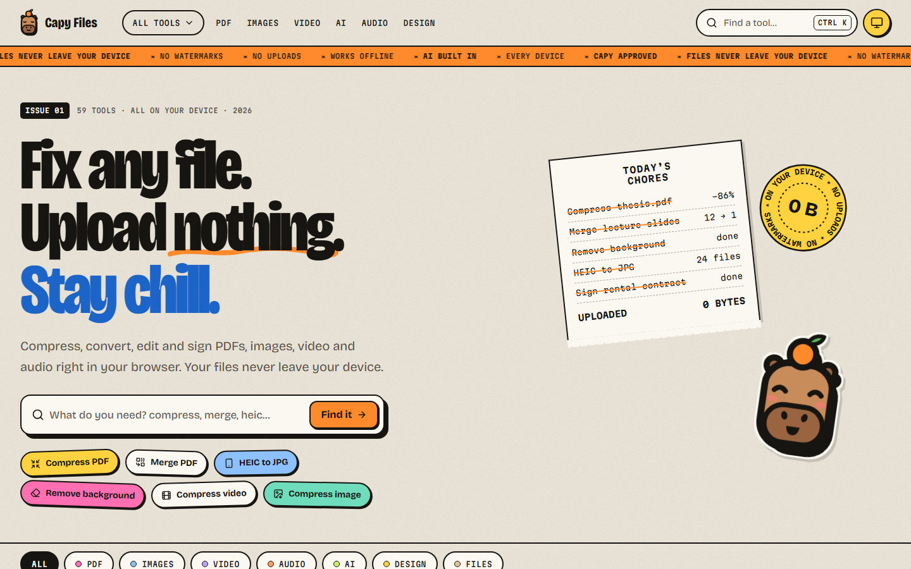 
      <b>Home: search, popular tools, every category</b>
    </td>
    <td align="center" width="50%">
      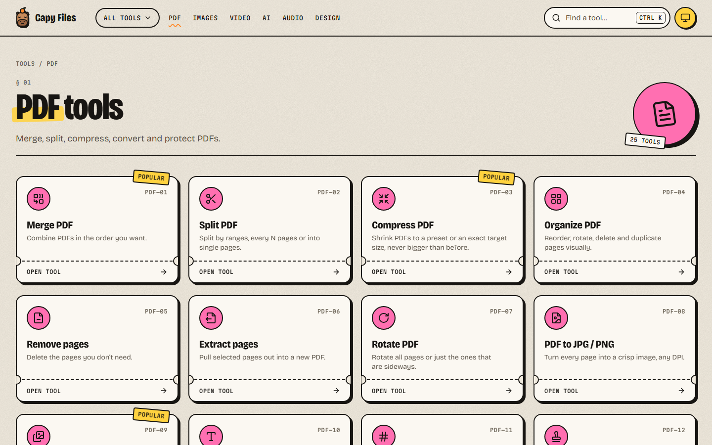 
      <b>Tool catalogue: 25 PDF tools</b>
    </td>
  </tr>
  <tr>
    <td align="center" width="50%">
      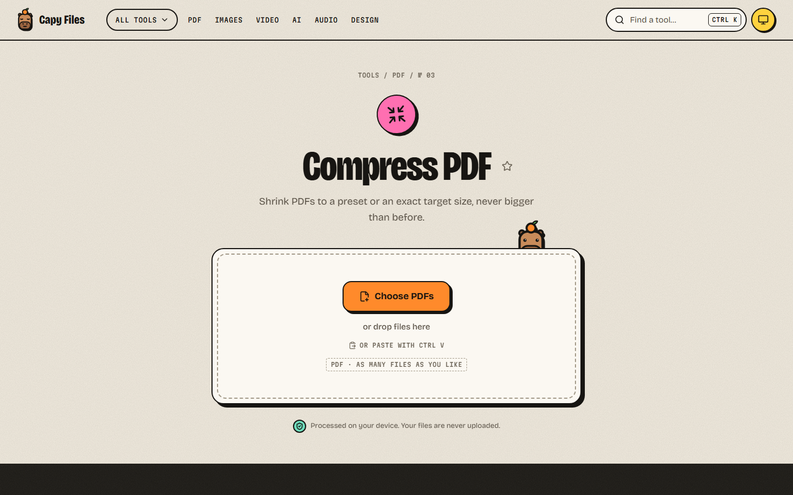 
      <b>Compress PDF: preset or exact target size</b>
    </td>
    <td align="center" width="50%">
      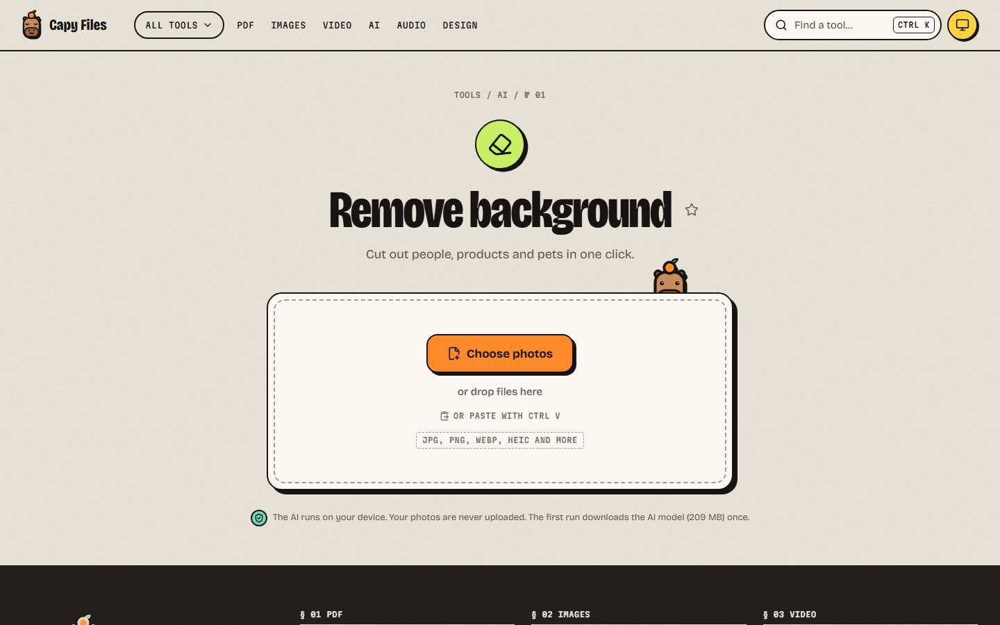 
      <b>Background removal with an on-device model</b>
    </td>
  </tr>
  <tr>
    <td align="center" width="50%">
      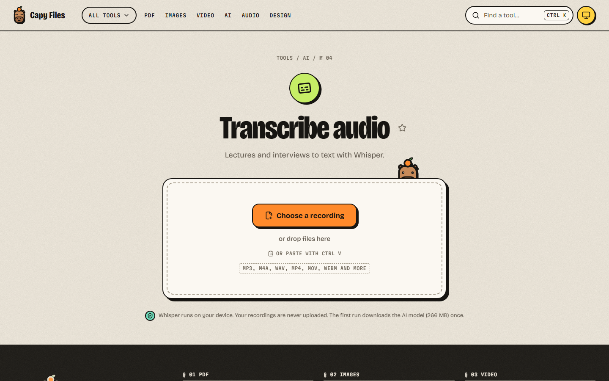 
      <b>Whisper transcription in the browser</b>
    </td>
    <td align="center" width="50%">
      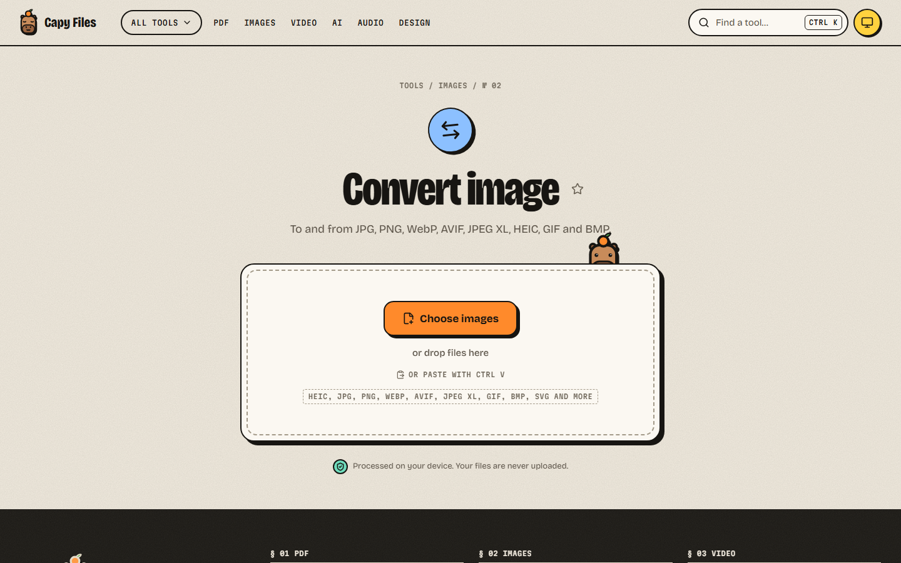 
      <b>Image conversion: HEIC, JPG, PNG, WebP, AVIF, JPEG XL</b>
    </td>
  </tr>
</table>

<table>
  <tr>
    <td align="center">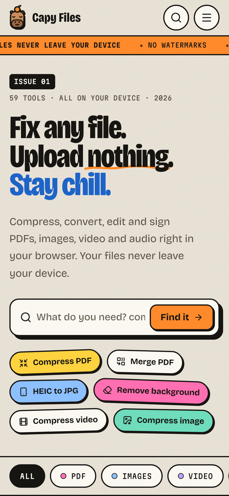 <b>Home</b></td>
    <td align="center">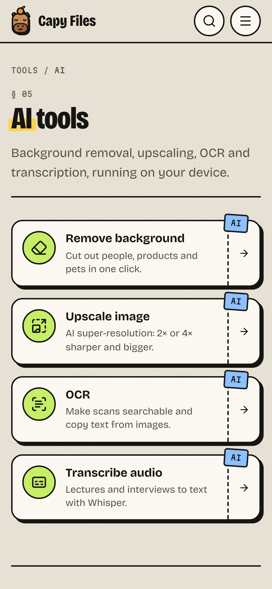 <b>AI tools</b></td>
    <td align="center">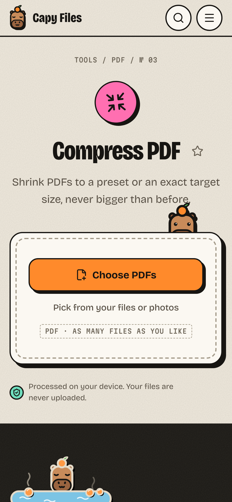 <b>Compress PDF</b></td>
    <td align="center">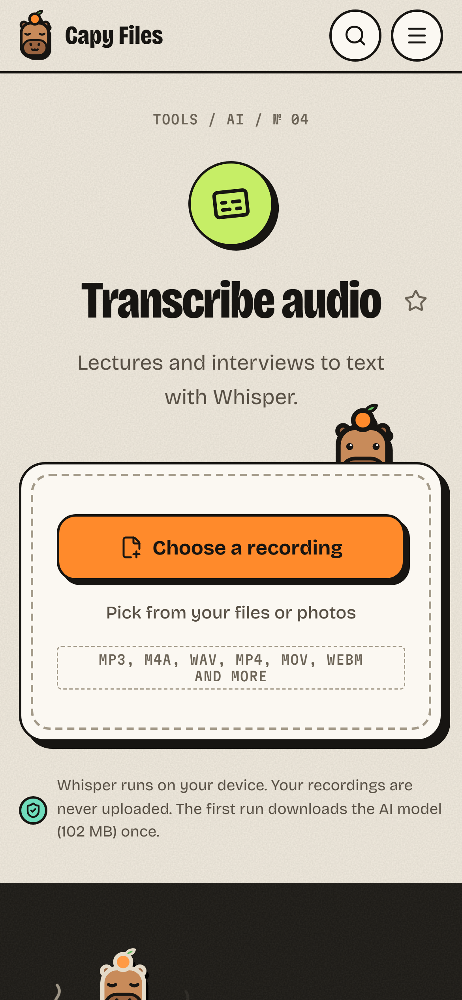 <b>Transcribe</b></td>
  </tr>
</table>

## Tools

59 released tools in seven categories (counted from the production tool registry):

| Category | Tools | Examples |
| --- | ---: | --- |
| PDF | 25 | Compress, merge, split, organise, edit, sign, redact, compare, protect / unlock, PDF/A, scan to PDF |
| Images | 11 | Compress, convert, HEIC to JPG, resize, crop, remove metadata, image to SVG, photo editor, face blur |
| Video | 7 | Compress, convert, trim, video to GIF, extract audio, mute, screen recorder |
| Audio | 4 | Compress, convert, trim, voice recorder |
| AI | 4 | Background removal, 4× upscaling, OCR, transcription |
| Design | 6 | Palette from image, contrast checker, QR codes, colour converter, gradients, device mockups |
| Files | 2 | Zip, unzip |

## Engineering highlights

- **AI on the device.** Models run through Transformers.js and ONNX Runtime Web on **WebGPU** (half precision where the GPU
  supports it), with an automatic **WebAssembly CPU fallback**:
  - **BiRefNet Lite** for background removal
  - **RealPLKSR** for 4× super-resolution
  - **YuNet** for face detection (face blur)
  - **Whisper** (base, small, large-v3 turbo) for transcription
  - **Tesseract** for OCR
- **WebAssembly engines.** qpdf, MozJPEG and OxiPNG, pdf.js and pdf-lib, and WebCodecs-based video and audio processing.
  It also includes a **custom PDF compressor** written to replace AGPL-licensed Ghostscript.
- **Edge hosting.** Cloudflare Workers serve the app and the API, with D1 as the database and R2 for model files. Large
  model downloads are **resumable**: a dropped connection continues from the last byte instead of starting over.
- **Offline, installable PWA.** A service worker caches the app shell and the engines a tool has already used.
- **SEO without a server renderer.** Every public page is **pre-rendered to static HTML at build time** (titles, canonical
  links, Open Graph, JSON-LD, sitemap). React takes over in the browser.
- **Payments and accounts.** Paddle subscriptions as merchant of record, with **signature-verified, idempotent
  webhooks**, Firebase Authentication (Google and email link), and scheduled renewal-reminder emails.
- **Security and quality.**
  - Strict Content Security Policy, HSTS and a locked-down Permissions-Policy.
  - **Cross-origin isolation only on pages that need it.**
  - TypeScript strict with no `any`.
  - **276 unit tests**, and CI runs typecheck, lint, tests and build.
  - An **automated licence compliance check** fails the build on GPL, AGPL or non-commercial dependencies and models.

## Architecture

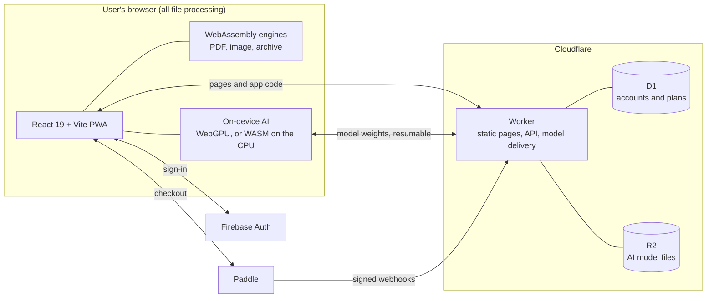

Files never travel on any of these arrows. The network carries the app itself, the AI model weights (downloaded once
and cached), and, for paying users, account and subscription state. More in
[docs/architecture.md](docs/architecture.md) and [docs/on-device-ai.md](docs/on-device-ai.md).

## Tech stack

| Area | Technology |
| --- | --- |
| Frontend | React 19, TypeScript (strict), Vite, Tailwind CSS 4, React Router |
| Processing | WebAssembly (qpdf, MozJPEG, OxiPNG, Tesseract), pdf.js, pdf-lib, WebCodecs, Web Workers |
| AI | Transformers.js, ONNX Runtime Web, WebGPU, WASM SIMD + threads |
| Hosting | Cloudflare Workers, D1, R2, rate limiting, cron triggers |
| Accounts and billing | Firebase Authentication, Paddle (merchant of record), transactional email |
| Offline | Service worker (Workbox), installable PWA |
| Quality | Vitest, oxlint, GitHub Actions, licence compliance check, pre-render on every build |

## What I built

I designed, built and launched Capy Files solo: product, visual identity and mascot, every tool, the processing
engines, the AI pipeline, hosting and security headers, payments and accounts, legal pages, and SEO. It is sold
through my company, Devinfi OOD.

## Challenges and decisions

- **Running Whisper in a browser tab.** The accurate model is hundreds of megabytes. It runs in a Web Worker so the page
  stays responsive, and the model size is picked for the device (large-v3 turbo on WebGPU, small on the CPU). Lectures
  are transcribed in 30-second windows using Whisper's long-form method, with silence skipped so the model doesn't
  invent text. Downloads resume from the last byte after a dropped connection, and the model is cached so the second
  run starts immediately.
- **WebGPU when it's there, the CPU when it isn't.** Every model runs on WebGPU (in half precision when the GPU supports
  it) and falls back to multi-threaded WebAssembly. The fallback is chosen per device and is invisible to the user; the
  same code path serves a gaming PC and a five-year-old laptop.
- **Replacing Ghostscript for licensing reasons.** Ghostscript is AGPL, which doesn't fit a closed-source product. I wrote
  a PDF compressor instead. It walks the document, recompresses images by their effective on-page resolution with
  MozJPEG, keeps transparency masks intact, removes duplicate images, and slims embedded fonts, then qpdf repacks the
  file. The result is never bigger than the input. For the same reason, a GPL image quantiser was replaced with my own,
  and the background-removal model was swapped for an MIT-licensed one.
- **Cross-origin isolation only where it pays off.** Multi-threaded WebAssembly needs `SharedArrayBuffer`, which needs
  COOP/COEP headers. Those headers also break third-party sign-in and checkout popups. Tool pages are isolated;
  sign-in, checkout, account and legal pages are not. One shared header policy generates the static headers and
  the Worker's headers, and tests prove every path gets exactly the policy's headers. Navigating across the boundary is
  always a full page load.
- **SEO for a single-page app without a server renderer.** All public pages are rendered to static HTML at build
  time. The app then renders over them, with a guard that hides a cached page shell if the service worker served it for
  a different URL.

## License

Proprietary. All rights reserved. This repository contains documentation and screenshots only; see [LICENSE](LICENSE).
